  

**SWORT Aerospace** designs custom flight computers, GNC hardware and embedded avionics to a program's requirements. The team is US-based, every delivery is source-complete, and a fixed-price quote comes back within 48 hours.

### Capabilities

| | |
|---|---|
| **PCB design and architecture** | Schematic capture and layout in KiCad or Altium: mixed-signal boards, controlled impedance, power integrity and DFM-reviewed output. |
| **Embedded systems** | Deterministic firmware on STM32-class targets: register-level peripheral work, interrupt and DMA architecture, RTOS task design. |
| **Avionics integration** | Flight computer and GNC hardware, interface definition, and bring-up from power rails through sensor validation. |
| **Firmware development** | Version-controlled, documented firmware delivered with unit tests and an integration guide. No locked toolchains. |
| **Sensor and telemetry integration** | Inertial, navigation, magnetic, barometric and environmental sensing, link design, and ground-side handling of vehicle data. |
| **Manufacturing coordination** | Fabrication and assembly through external vendors, with DFM review and incoming inspection. SWORT does not run an in-house production line. |
| **Simulation and fault injection** | Sensor and disturbance models, induced-fault scenarios, and hardware-in-the-loop runs of firmware against representative dynamics. |
| **Research and development** | Sensor integrity, residual consistency and fault isolation, including the SSIL commercial integrity layer. |
| **Engineering services** | Requirements capture, architecture and interface definition, verification planning and technical documentation. |

### How we work

1. **Requirements first.** Each engagement starts from the program's requirements, not from a catalogue part.
2. **Agreed in writing.** Scope, interfaces and acceptance criteria are fixed before work begins.
3. **Delivered source-complete.** Firmware source, schematics, BOM, wiring diagrams, and the test records behind the result.

To start, [send your requirements](https://swort.net/#intake) or [book a free 45-minute technical brief](https://swort.net/book) with the engineering team.

### Open source

| | |
|---|---|
| **[csia-trust-layer](https://github.com/SWORT-Aerospace/csia-trust-layer)** | Runtime sensor assurance for autonomous aircraft. It decides which sensors to trust and reports faults as a probability over causes. Python runtime with a zero-allocation C core. |
| **[sem-motor-controller](https://github.com/SWORT-Aerospace/sem-motor-controller)** | A telemetry-informed motor controller for a battery-electric vehicle, with a portable C11 core verified in host co-simulation. |

### Federal registration

| | |
|---|---|
| Legal name | SWORT LLC, operating as SWORT Aerospace |
| SAM.gov | Active |
| UEI | `CM95U729C6K9` |
| CAGE | `21UQ1` |
| Primary NAICS | 541330, Engineering Services |

Registration information does not imply government endorsement, contract award, certification, product qualification, or security clearance.

> [!IMPORTANT]
> GitHub, this organization's repositories and ordinary email are not approved systems for classified information, Controlled Unclassified Information, or export-controlled technical data. Do not post such material in an issue, pull request or discussion. SWORT will arrange an appropriate method before any such material is exchanged.

### Contact

[swort.net](https://swort.net) · [Government capabilities](https://swort.net/government-capabilities) · [Research partnerships](https://swort.net/research-partnerships) · contact@swort.net

Security reports go to contact@swort.net with the subject `SECURITY`, never to a public issue. See the [security policy](https://github.com/SWORT-Aerospace/.github/blob/main/SECURITY.md).
